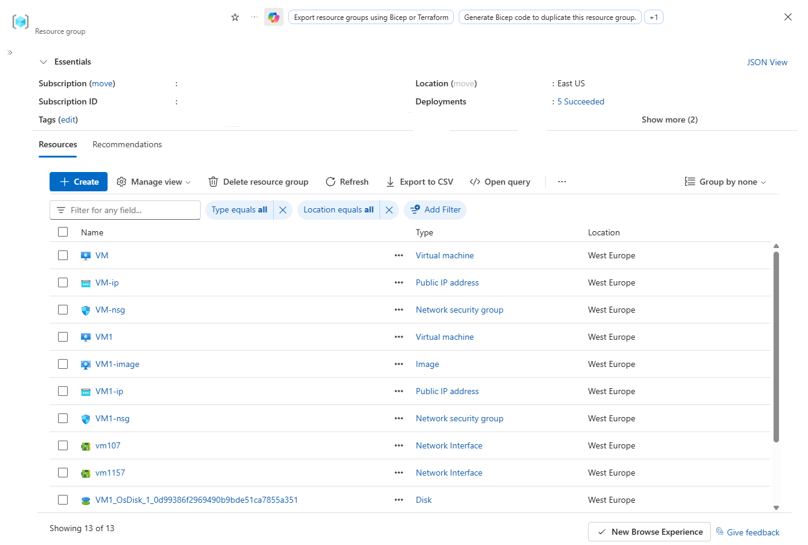
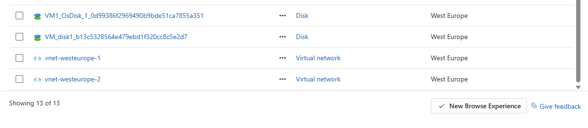
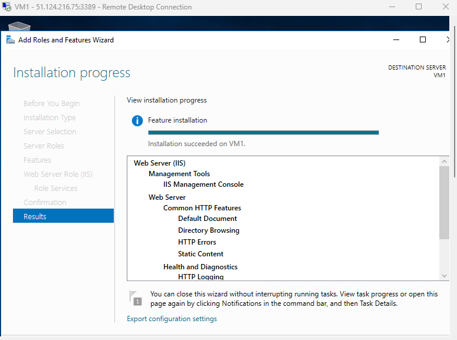
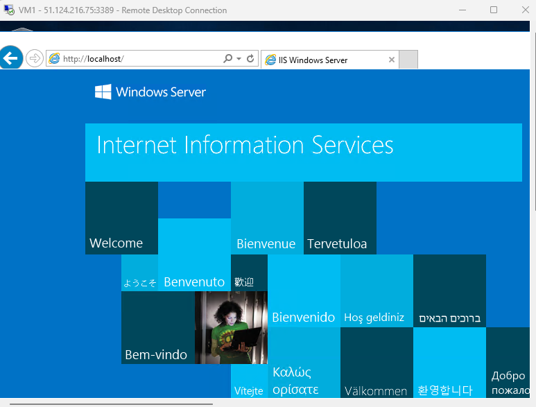
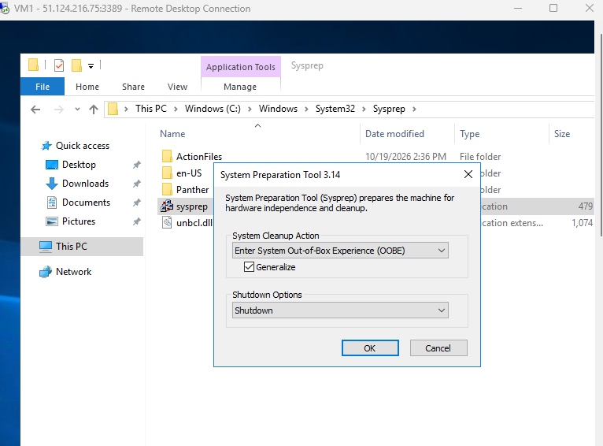
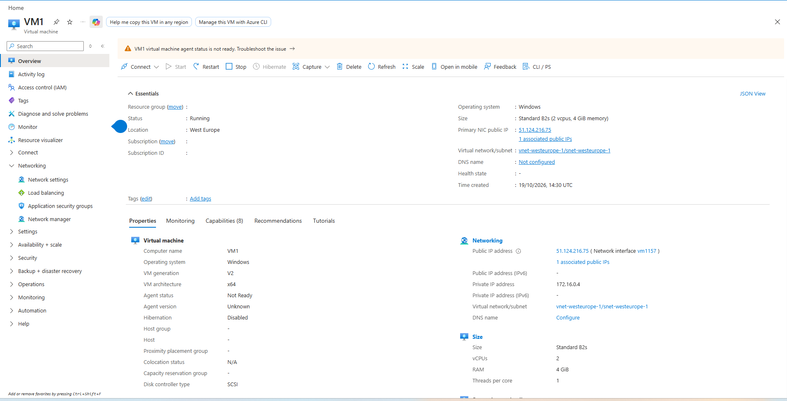
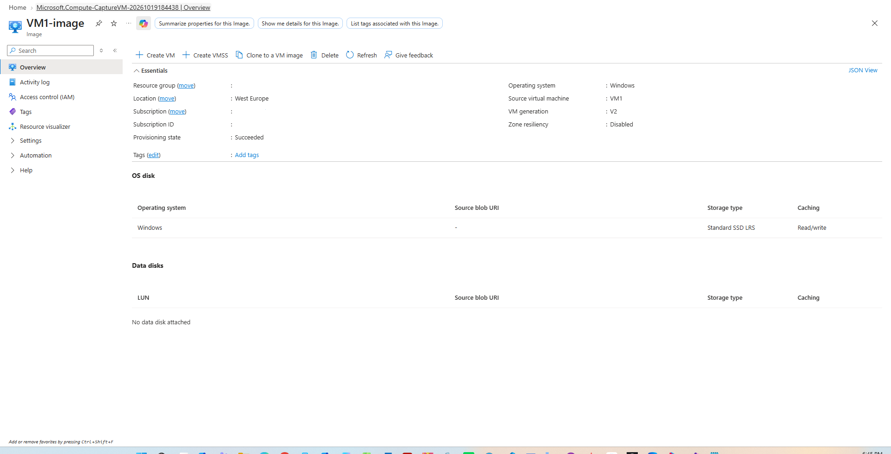
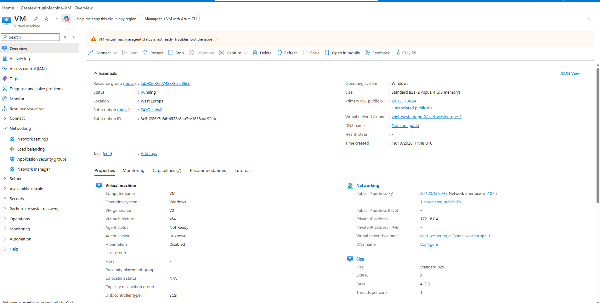
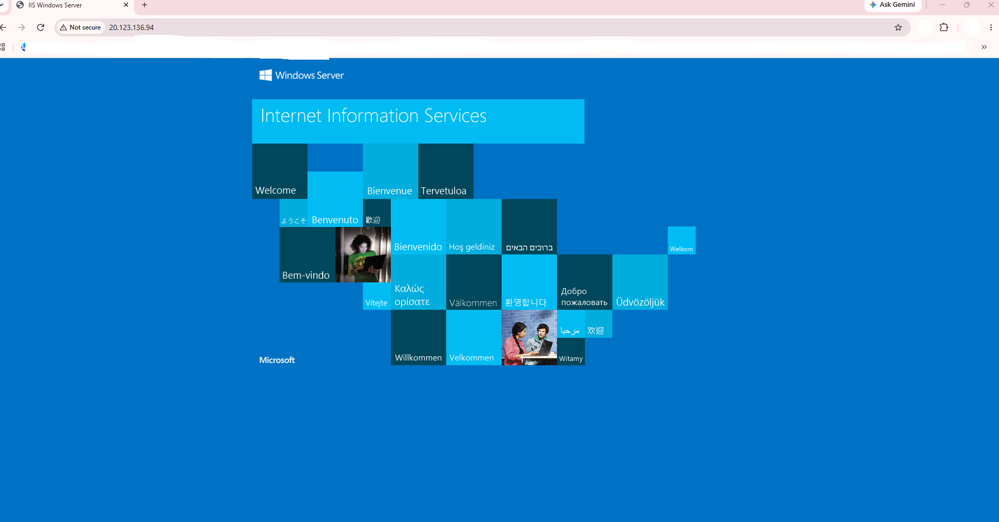

# Provisioning Windows Virtual Machines from Custom Managed Images in Azure

Comprehensive laboratory deployment detailing the complete lifecycle of capturing a generalized Windows Server virtual machine with Internet Information Services (IIS) installed, creating a custom managed image, and deploying a new VM instance using the captured custom image.

---

## 1. Architecture & Provisioned Resources

### Core Infrastructure Topology

| Resource Type | Resource Name | Specification / Tier | Region / Location |
| :--- | :--- | :--- | :--- |
| **Source Virtual Machine** | `VM1` | Standard_B2s, Windows Server 2016 Datacenter | West Europe |
| **Custom VM Image** | `VM1-image` | Generalized V2 Managed Image (Windows OS) | West Europe |
| **New Virtual Machine** | `VM` | Standard_B2s (Provisioned from `VM1-image`) | West Europe |
| **Source Virtual Network** | `vnet-westeurope-1` | `172.16.0.0/16` (`snet-westeurope-1`: `172.16.0.0/24`) | West Europe |
| **Target Virtual Network** | `vnet-westeurope-2` | `172.16.0.0/16` (`snet-westeurope-1`: `172.16.0.0/24`) | West Europe |
| **Network Security Groups** | `VM1-nsg`, `VM-nsg` | Inbound Rules: HTTP (80), RDP (3389) | West Europe |
| **Public IP Addresses** | `VM1-ip`, `VM-ip` | Static Standard IPv4 (`51.124.216.75`, `20.123.136.94`) | West Europe |

---

### Provisioned Environment Validation

*Resource group inventory confirming the presence of the source VM, target VM, custom managed image, public IP addresses, network security groups, network interfaces, and OS disks.*

---

*Additional resource group overview displaying attached OS managed disks and distinct virtual networks for both source and target environments.*

---

## 2. Step-by-Step Implementation

### Step 1: Install Web Server (IIS) Role on Source VM

Connected to `VM1` via Remote Desktop Protocol (RDP) and configured the Web Server (IIS) role using the Add Roles and Features Wizard.

*Installation progress confirmation showing successful deployment of Web Server (IIS) role and management tools on VM1.*

---

### Step 2: Validate Local Web Server Functionality

Opened Internet Explorer within the remote session and navigated to `http://localhost/` to verify default IIS landing page rendering.

*Successful local validation of the IIS Windows Server default welcome page on VM1.*

---

### Step 3: Generalize the Windows Operating System via Sysprep

Executed the System Preparation Tool (`sysprep.exe`) with Out-of-Box Experience (OOBE), Generalize option checked, and Shutdown option selected to prepare the OS for image capturing.

*Running Sysprep tool to remove computer-specific information and shut down the VM for generalization.*

---

### Step 4: Capture Custom VM Managed Image

Navigated to `VM1` in the Azure Portal, initiated the capture process, and created the managed image resource `VM1-image`.

*Source virtual machine VM1 in stopped state ready for image capture.*

---

*Successfully generated custom managed image VM1-image sourced from VM1.*

---

### Step 5: Provision New Virtual Machine from Custom Image

Deployed a new virtual machine named `VM` using `VM1-image` as the boot source and attached it to `vnet-westeurope-2`.

*Overview pane of newly provisioned virtual machine VM running from the custom managed image.*

---

### Step 6: Verify Web Server Functionality on Provisioned VM

Accessed the public IP address of `VM` (`20.123.136.94`) in a web browser to confirm that the pre-configured IIS installation persisted through the custom image deployment.

*Successful public HTTP validation confirming operational IIS web server on the newly created virtual machine.*
